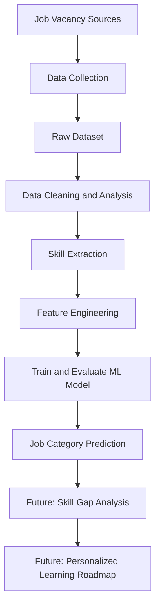

<div align="center">

# 🚀 AI Career & Skill Analyzer

### Turn skills into career possibilities.

An intelligent career exploration platform connecting **skills, job requirements, and career paths** through Natural Language Processing and Machine Learning.


</div>

---

## ✨ What is it?

**AI Career & Skill Analyzer** is a Machine Learning project that aims to help people explore career directions by analyzing skills and comparing them with real job-market requirements.

The project collects job-vacancy data, prepares and analyzes the text, extracts relevant skills, and develops an ML pipeline to classify vacancies into meaningful job categories. The longer-term goal is to help users understand which career paths may fit their skills and what they could learn next.

> **Our vision:** Make career exploration more data-driven, understandable, and accessible.

## 🎯 The Problem

Choosing a career can be difficult when job titles are inconsistent, required skills are scattered across vacancy descriptions, and it is unclear how a person's current skills compare with market expectations.

We are building a data-driven foundation to help organize this information and support more informed career exploration.

## 💡 Planned Features

- 🔎 **Vacancy analysis** — process job titles, descriptions, and requirements.
- 🧠 **ML-based classification** — predict a job category from vacancy text.
- 🛠️ **Skill extraction** — identify technologies and skills mentioned in job descriptions.
- 📊 **Skill-gap analysis** — compare a user's skills with requirements for a selected career or vacancy.
- 🧭 **Career exploration** — surface potentially relevant career directions.
- 🗺️ **Learning roadmap** — suggest skills to focus on next (planned).
- 📈 **Model evaluation** — measure performance using appropriate classification metrics.

*The project is under active development. Planned functionality should not be interpreted as already implemented.*

## ⚙️ How It Works



### Machine Learning Approach

The first ML task is **supervised text classification**:

- **Input (`X`):** cleaned vacancy text and selected job-related features.
- **Target (`y`):** a validated job category.
- **Baseline model:** TF-IDF + Logistic Regression.
- **Evaluation:** precision, recall, F1-score, and confusion matrix; accuracy can also be reported when appropriate.

TF-IDF converts text into numerical features so a classifier can learn patterns associated with job categories. We will consider more advanced models after the baseline works and the labels have been checked.

## 🧰 Tech Stack

| Technology | Purpose |
|---|---|
| Python | Main programming language |
| pandas | Data processing and analysis |
| scikit-learn | Text vectorization, model training, evaluation |
| Matplotlib | Exploratory data visualizations |
| Regular expressions (`re`) | Text cleaning and skill matching |
| Jupyter Notebook | Experiments and analysis |
| CSV | Dataset storage during development |
| Git & GitHub | Version control and collaboration |

## 📂 Project Structure

The repository may evolve during development. A typical structure is:

```text
AI-Career-Analyzer/
├── datalar/
│   ├── processed/
│   ├── 2_scrape_details.py
│   └── 4_clean_data.py
├── notebooks/
│   └── 04_ml_analysis.ipynb
├── data/
│   ├── raw/
│   └── processed/
├── src/
├── README.md
└── requirements.txt
```

Keep this tree aligned with the actual repository files as the project grows. The project has used Azerbaijani job-vacancy data from HelloJob during development.

## 🚀 Getting Started

### 1. Clone the repository

```bash
git clone https://github.com/simanly/AI-Career-Analyzer.git
cd AI-Career-Analyzer
```

If your repository URL or capitalization differs, use the URL shown on your GitHub repository page.

### 2. Create a virtual environment (recommended)

**Windows PowerShell**

```powershell
python -m venv .venv
.\.venv\Scripts\Activate.ps1
```

**macOS / Linux**

```bash
python3 -m venv .venv
source .venv/bin/activate
```

### 3. Install dependencies

If a `requirements.txt` file is available:

```bash
pip install -r requirements.txt
```

Otherwise, install the packages currently used for analysis:

```bash
pip install pandas scikit-learn matplotlib jupyter
```

### 4. Run the analysis

Open the project in VS Code or start Jupyter:

```bash
jupyter notebook
```

Open the ML analysis notebook and run the cells in order. Update dataset paths in the notebook if your local folder structure differs.

> **Data note:** Run collection scripts only after confirming their input/output paths and the applicable terms of the source website.

## 📊 Evaluation Plan

We will assess the model using:

- **Precision:** how many predictions for a class were correct.
- **Recall:** how many examples of a class the model successfully found.
- **F1-score:** a balance between precision and recall.
- **Confusion matrix:** which categories the model confuses.
- **Accuracy:** the overall fraction of correct predictions.

Because job categories may be imbalanced, **macro F1-score** will be especially useful alongside per-class metrics. We will also check for duplicate records, poor-quality descriptions, noisy skill extraction, and unreliable labels before drawing conclusions from model results.

## 🛣️ Roadmap

- [x] Define the project concept and initial ML task
- [x] Collect an initial set of job-vacancy records
- [x] Create a preliminary data-cleaning workflow
- [x] Begin exploratory data analysis
- [ ] Validate and normalize job-category labels
- [ ] Improve description cleaning and skill extraction
- [ ] Build the TF-IDF + Logistic Regression baseline
- [ ] Evaluate and document model performance
- [ ] Compare additional models
- [ ] Save the trained model and build a prediction interface
- [ ] Develop user-profile matching and skill-gap analysis
- [ ] Explore personalized learning recommendations

## ⚠️ Current Limitations

- The project is **under active development**; not all features are available yet.
- Automatically generated job groups may contain incorrect labels and must be validated.
- Some vacancy descriptions may be truncated or contain website navigation text.
- Extracted skills can include false positives and require refinement.
- A model trained on vacancy categories predicts labels in the training data; it does **not automatically prove** that a career is suitable for a particular person.
- Model quality depends on data quality, label consistency, category balance, and evaluation design.

## 🔐 Data, Ethics & Responsible Use

- Respect the terms of service, access rules, and applicable laws of data sources.
- Store only data that the project is permitted to collect and use.
- Do not treat model predictions as definitive career advice.
- Be transparent about uncertainty and limitations.
- Avoid exposing personal or sensitive information in datasets, logs, or demonstrations.

## 🤝 Contributing

Contributions and feedback are welcome!

1. Create a feature branch.
2. Make a focused change.
3. Test your changes and document important decisions.
4. Open a Pull Request describing what changed and why.

```bash
git checkout -b feature/your-feature
git add .
git commit -m "Describe your change"
git push -u origin feature/your-feature
```

## 👥 Team

Built as a collaborative Machine Learning project by the **AI Career & Skill Analyzer** team.

Add team members and their GitHub profiles here when the team list is finalized.

## 📄 License

No license has been specified yet. Until a license is added to the repository, reuse and redistribution of this project's code should not be assumed to be permitted. Add a `LICENSE` file when the team decides on a license.

---

<div align="center">

**Built with curiosity, data, and a little bit of AI.** 🤖

⭐ Follow the project on GitHub to see its progress.

</div>
